# ConstructIQ™ — AI-Powered Multimodal Construction Intelligence Platform

[](https://python.org)
[](https://fastapi.tiangolo.com)
[](https://react.dev)
[](https://vitejs.dev)
[](https://vercel.com/new/clone?repository-url=https%3A%2F%2Fgithub.com%2FAbhiSethiya%2FMultimodal-Construction-Intelligence-Platform)
[](https://docs.pydantic.dev)
[](https://www.osha.gov)

[](https://vercel.com/new/clone?repository-url=https%3A%2F%2Fgithub.com%2FAbhiSethiya%2FMultimodal-Construction-Intelligence-Platform)

> **ConstructIQ™** is an intelligent, full-stack decision-support system designed to assist construction professionals across multiple stages of construction planning, execution, and monitoring. The platform leverages multimodal artificial intelligence to interpret unstructured data (site photos, crack imagery, blueprints, field voice notes) and generate real-time, context-aware engineering insights.

---

## 🏗️ Platform Overview & Architecture

```mermaid
flowchart TD
    subgraph Client["React.js Frontend (Vite + Modern Vanilla CSS)"]
        UI_Dash["Executive Command Center"]
        UI_Safety["Safety Vision AI (Interactive BBoxes)"]
        UI_Crack["Crack Health & Millimeter Gauge"]
        UI_Val["Real Estate Valuation Engine"]
        UI_Plan["Project Planning & WBS Gantt"]
        UI_Log["Daily Site Assistant & DPR Logbook"]
        UI_Weather["Weather-Aware Risk Advisory"]
        UI_Know["Construction Knowledge Copilot"]
    end

    subgraph DataContracts["Strict JSON Contracts (Pydantic v2)"]
        C1["SafetyAuditSchema"]
        C2["CrackAnalysisSchema"]
        C3["ValuationSchema"]
        C4["ProjectPlanningSchema"]
        C5["DailyLogSchema"]
        C6["WeatherAdvisorySchema"]
        C7["KnowledgeSchema"]
    end

    subgraph Server["FastAPI Backend (REST API)"]
        R_Safety["POST /api/safety/analyze"]
        R_Crack["POST /api/crack/analyze"]
        R_Val["POST /api/valuation/estimate"]
        R_Plan["POST /api/planning/generate"]
        R_Log["POST /api/daily-log/process"]
        R_Weather["POST /api/weather/advisory"]
        R_Know["POST /api/knowledge/ask"]
    end

    subgraph Intelligence["Multimodal AI Reasoning Engine"]
        GEMINI["Google Gemini Multimodal API"]
        CIVIL_ENGINE["Deterministic Civil Engineering Engine"]
        STANDARDS["OSHA 1926 • ACI 318 • ASTM C143 • Eurocode 2"]
    end

    Client <--> DataContracts
    DataContracts <--> Server
    Server <--> Intelligence
```



---

## ⚡ Core Intelligent Modules

### 1. 🦺 Construction Site Safety Monitoring
- **Multimodal Visual Scanner**: Analyzes construction imagery and live telemetry for Personal Protective Equipment (PPE) compliance (helmets, Class 2/3 hi-vis vests, secondary safety lanyards).
- **Hazard Identification**: Flags unguarded leading edges and unharnessed workers operating at elevations $\ge 6\text{ ft}$ per **OSHA 1926.501(b)(1)**.
- **Dynamic Bounding Boxes**: Outputs normalized coordinates rendered dynamically on an interactive canvas with severity tiers (*Low, High, Critical Stop-Work*) and OSHA regulation references.

### 2. 🔍 Crack Detection & Structural Health Analysis
- **Crack Topology Classification**: Differentiates between diagonal shear cracks, hairline plastic shrinkage fissures, flexural tension cracks, and differential settlement cracks.
- **Sub-Millimeter Calibrated Gauge**: Estimates crack width ($3.42\text{ mm}$ detected vs $0.30\text{ mm}$ ACI 224R permissible limit), depth profile, and structural integrity score ($48/100$).
- **Remediation Protocols**: Triggers emergency temporary shoring alarms and formulates step-by-step repair remediation conforming to **ACI 224R-01** (Shoring $\to$ V-groove Prep $\to$ Low-viscosity Epoxy Injection $\to$ CFRP U-Wraps).

### 3. 🏢 Real Estate & Asset Valuation Engine
- **Stage-of-Construction Verification**: Inspects architectural elevations and building enclosure progress.
- **Cost-to-Complete Estimation**: Computes current market value, completed asset value, price per sq.ft benchmark, and residual Capex.
- **Cost Breakdown & Comps**: Categorizes expenditures into substructure, superstructure framing, curtain wall facade, and MEP systems alongside local market comparables.

### 4. 📅 Construction Project Planning & WBS Gantt
- **Multi-Phase Schedule Breakdown**: Generates 5 standardized phases (Preconstruction & Excavation, Substructure, Superstructure, Enclosure & MEP, Interior Commissioning).
- **Critical Path Method (CPM)**: Identifies schedule bottlenecks, displays milestone targets, and visualizes task progress on an interactive Gantt chart.
- **Risk Mitigation Matrix**: Identifies supply chain, weather, and municipal inspection hazards with mitigation strategies.

### 5. 📝 Daily Site Assistant & DPR Auto-Logbook
- **Voice & Field Dictation Synthesis**: Translates unstructured radio transcripts and supervisor notes into formal Daily Progress Reports (DPR).
- **Resource Analytics**: Tracks trade manpower headcount distributions (Masons, Rebar Fabricators, MEP Technicians, Scaffolders, HSE Officers).
- **Quality Control**: Logs equipment operating hours, logistics transit delays, and material intake with Mill Test Certificate (MTC) verifications.

### 6. ⛅ Weather-Aware Construction Safety Advisory
- **Concrete Hydration Index**: Evaluates hot-weather rapid drying risks (**ACI 305R-20**) and cold-weather curing delays (**ACI 306R**).
- **Crane Wind Cutoff Safeguards**: Enforces strict wind velocity thresholds ($>38\text{ km/h} \approx 20\text{ knots}$) per **OSHA 1926 Subpart CC**.
- **Excavation Stability**: Predicts trench bank slump and hydrostatic saturation hazards.
- **Operational Shift Windows**: Formulates hourly work windows indicating allowed vs restricted tasks.

### 7. 💬 Construction Knowledge & Engineering Copilot
- **Code Citations**: Answers technical queries with verified clauses from **ACI 318-19**, **OSHA 1926**, **AISC 360-16**, and **Eurocode 2**.
- **Engineering Equations**: Displays governing formulas (slump subtraction equations, clear rebar spacing bounds, fall clearance envelopes).
- **Field Checkpoints**: Practical checklists tailored for site inspection walkthroughs.

---

## 🔒 Security & Credentials Notice

This repository strictly adheres to secure engineering practices:
- **No API keys or sensitive credentials are committed.**
- All environment configurations use `.env.example` templates.
- Full offline / local operation is enabled out of the box through high-precision deterministic civil engineering algorithms.

---

## 🚀 Quick Start Guide

### Prerequisites
- **Python 3.10+**
- **Node.js 18+** & **npm**

### 1. Backend Setup (FastAPI)
```bash
# Navigate to backend directory
cd backend

# Create and activate virtual environment (optional)
python -m venv venv
# Windows:
.\venv\Scripts\activate
# Linux/macOS:
source venv/bin/activate

# Install dependencies
pip install -r requirements.txt

# (Optional) Copy environment template and add your Gemini API key
cp .env.example .env

# Run FastAPI dev server
python -m uvicorn main:app --host 127.0.0.1 --port 8000 --reload
```
*Backend Swagger UI will be available at:* `http://127.0.0.1:8000/docs`

### 2. Frontend Setup (React + Vite)
```bash
# Navigate to frontend directory
cd frontend

# Install dependencies
npm install

# Run Vite dev server
npm run dev
```
*Frontend interface will be available at:* `http://127.0.0.1:5173`

---

## 📋 Strict JSON Data Contract Summary

| Router | Endpoint | Schema Model | Purpose |
| :--- | :--- | :--- | :--- |
| `safety.py` | `POST /api/safety/analyze` | `SafetyAuditResponse` | Visual PPE & fall hazard detection with coordinates |
| `crack.py` | `POST /api/crack/analyze` | `CrackAnalysisResponse` | Crack width, structural score & ACI repair plan |
| `valuation.py` | `POST /api/valuation/estimate` | `ValuationResponse` | Asset appraisal & cost-to-complete breakdown |
| `planning.py` | `POST /api/planning/generate` | `ProjectPlanningResponse` | 5-phase WBS & critical path task schedule |
| `daily_log.py` | `POST /api/daily-log/process` | `DailyLogResponse` | Voice notes to formal DPR and manpower tracking |
| `weather.py` | `POST /api/weather/advisory` | `WeatherAdvisoryResponse` | ACI/OSHA curing, crane, and excavation safety limits |
| `knowledge.py` | `POST /api/knowledge/ask` | `ConstructionKnowledgeResponse` | Standard code QA with formulas & field checklists |

---

## 📄 License
This project is licensed under the [MIT License](LICENSE).
